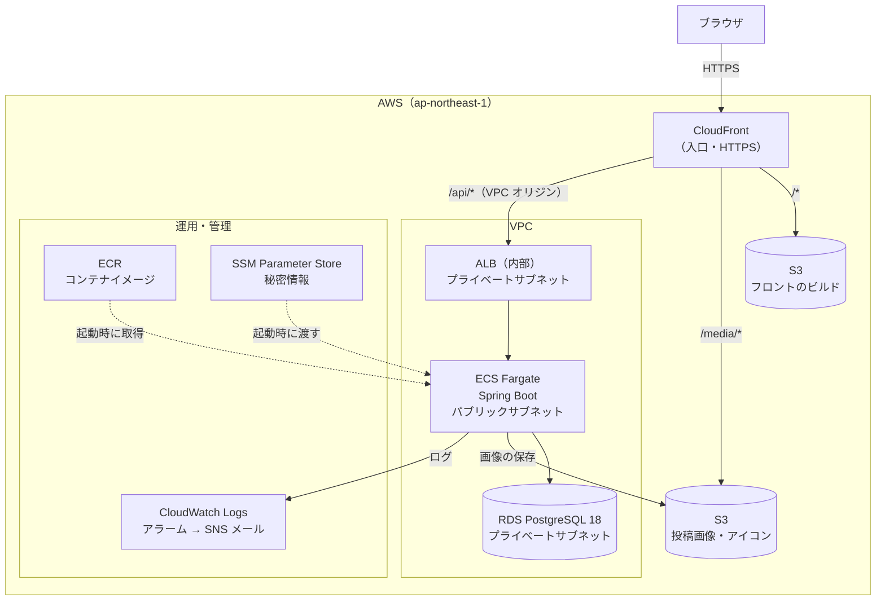

# AWS 構成

[目次に戻る](README.md)

本番環境は AWS の東京リージョン（`ap-northeast-1`）に作る。EC2 は使わず、フロントエンドは S3＋CloudFront で配信し、バックエンド（Spring Boot）は ECS Fargate のコンテナで動かす。普段は止めておき、講義やデモなど使うときだけ起動する。

- 決定日：2026-11-21（#6）
- 構築（Terraform・CD）は別の Issue で行う。この文書は構築の設計図として、決めたことと理由を残す

## 構成図

## なぜこの構成か

| 要件・制約 | この構成での対応 |
| --- | --- |
| ログイン状態の Cookie（`SameSite=Strict`）は、フロントと API が同じオリジンでないと送られない | CloudFront を唯一の入口にして、パスで S3 と API に振り分ける（ローカルで Vite が `/api` をプロキシしているのと同じ形） |
| EC2 を使わない | バックエンドは Fargate（サーバーの管理が不要なコンテナ実行環境）で動かす |
| Fargate のタスクは起動のたびに IP アドレスが変わる | ALB を間に置き、新しいタスクへ自動で振り分ける。API Gateway は 1 リクエスト 10MB の上限があり、画像 4 枚の投稿（最大 25MB）が通らないので使わない |
| Fargate はタスクを止めると中身が消える | DB は RDS、画像は S3 に置き、タスクは何も保持しない |
| 費用を抑えたい（クレジットは最大 $200） | NAT Gateway（月 $45 前後）を使わない。普段は止めておく（[起動と停止](#起動と停止)） |

## 各サービスの役割と設定

### CloudFront

ディストリビューションを 1 つ作り、パスで振り分ける（ビヘイビア）。当面はドメインを取らず、CloudFront の URL（`https://xxxx.cloudfront.net`）をそのまま使う。

| パス | オリジン | キャッシュ | 補足 |
| --- | --- | --- | --- |
| `/api/*` | ALB（VPC オリジン） | しない | すべてのメソッド・Cookie・クエリ・ヘッダー（Host 以外）を転送する |
| `/media/*` | S3（画像のバケット） | 長く（1 年） | 画像のキーは内容ごとに変わるので、長くキャッシュしてよい。CloudFront Functions で先頭の `/media` を外して S3 のキーにする |
| `/*`（既定） | S3（フロントのバケット） | `assets/` は長く、`index.html` はしない | 画面のパス（`/home`・`/users/...` など）は CloudFront Functions で `/index.html` に書き換える（SPA のため） |

- S3 のバケットは公開しない。CloudFront からだけ読めるようにする（OAC）
- SPA の振り分けに「エラー時に `index.html` を返す」設定（カスタムエラーレスポンス）は使わない。この設定はディストリビューション全体にかかり、API の 404（`NOT_FOUND` の JSON）まで `index.html` に置き換えてしまうため。CloudFront Functions を既定のビヘイビアにだけ付ける
- 料金は無料枠（月 1TB の転送・1,000 万リクエスト）に収まる見込み

### ALB（内部）とネットワーク

- ALB はプライベートサブネットに置く「内部」ALB にし、CloudFront の **VPC オリジン**でつなぐ。インターネットから ALB に直接は届かず、公開 IPv4 アドレスの料金もかからない
- ヘルスチェックは `/actuator/health`（ログに出さない設定にしてある。[運用](10_operations.md)）
- VPC は 2 つのアベイラビリティゾーンにまたがるパブリック・プライベートサブネットを作る（ALB と RDS のサブネットグループに 2 つ以上が必要なため）
- **NAT Gateway は使わない**。Fargate のタスクはパブリックサブネットに置いて公開 IP を付け、ECR・CloudWatch Logs・SSM へインターネット経由で出る。外からの通信は、セキュリティグループで ALB からだけに絞る
- S3 へはゲートウェイ型の VPC エンドポイント（無料）を通す

| セキュリティグループ | 受け付ける通信 |
| --- | --- |
| ALB | CloudFront の VPC オリジンから（HTTP 80） |
| Fargate のタスク | ALB から（8080） |
| RDS | Fargate のタスクから（5432） |

### ECS Fargate（バックエンド）

- タスクのサイズ：ARM（Graviton）、0.5 vCPU・メモリ 1GB、1 タスク。JVM のヒープはコンテナのメモリの 75% まで（`-XX:MaxRAMPercentage=75`）
- イメージは ECR に置く（Dockerfile は構築の Issue で作る）。タグは Git のコミット ID
- 環境変数（[application.yml](../backend/src/main/resources/application.yml) の値を上書きする）

    | 変数 | 値 |
    | --- | --- |
    | `DB_URL` | RDS のエンドポイント（`jdbc:postgresql://<RDS>:5432/timeline`） |
    | `DB_USERNAME`・`DB_PASSWORD` | SSM Parameter Store から（秘密） |
    | `JWT_SECRET` | SSM Parameter Store から（秘密。32 バイト以上） |
    | `STORAGE_BUCKET` | 画像のバケット名 |
    | `STORAGE_ENDPOINT` | 空（既定値はローカルの S3Mock なので、必ず空にする。空ならタスクの IAM ロールで本物の S3 につながる） |
    | `STORAGE_PUBLIC_BASE_URL` | `/media`（画像を API ではなく CloudFront から配る） |

- プロファイルは指定しない（本番の設定。ログは JSON、Swagger UI は無効）
- ログは `awslogs` ドライバで CloudWatch Logs の `/timeline-sns/backend` に送る（アプリは JSON を標準出力に出す作りになっている）
- DB のマイグレーション（Flyway）は起動時に自動で流れる。デプロイは新しいタスクが正常になってから古いタスクを止める（ローリング）ので、一時的に新旧のタスクが同じ DB を使う。スキーマの変更は、古いコードでも動く形（列の追加など）にする
- 起動にかかる時間（Spring Boot と Flyway）を見込んで、ヘルスチェックの猶予を 2 分ほどとる

### RDS（PostgreSQL）

- PostgreSQL 18（スキーマで `uuidv7()` を使うため 18 が必須。構築時に RDS が 18 に対応していることを確かめる）
- `db.t4g.micro`、シングル AZ、ストレージ gp3 20GB
- 公開しない（パブリックアクセスなし）。Fargate のタスクからだけつながる
- 拡張は `pg_trgm` を使う（ユーザー検索。RDS で使える）
- 自動バックアップは 7 日。削除保護を有効にし、削除するときは最終スナップショットを取る

### S3

| バケット | 中身 | 設定 |
| --- | --- | --- |
| フロント | `frontend/` の本番ビルド（`dist/`） | 非公開（CloudFront の OAC） |
| 画像 | 投稿画像・アイコン（[ImageProcessor](../backend/src/main/java/com/timelinesns/image/ImageProcessor.java) で変換済み） | 非公開（CloudFront の OAC）、バージョニング有効（誤削除に備える）、古いバージョンは 30 日で削除 |
| Terraform の状態 | Terraform の状態ファイル | 非公開、バージョニング有効 |

### 秘密情報と権限

- DB の認証情報と `JWT_SECRET` は SSM Parameter Store（SecureString）に置き、タスク定義の `secrets` で環境変数として渡す。リポジトリや Terraform のコードには書かない
- IAM ロールは用途ごとに分け、必要な権限だけを付ける

| ロール | 使う人 | 権限 |
| --- | --- | --- |
| タスクロール | 動いているアプリ | 画像のバケットの読み書き・削除 |
| タスク実行ロール | ECS（タスクの起動） | ECR からイメージを取る、CloudWatch Logs に書く、SSM の秘密を読む |
| デプロイ用ロール | GitHub Actions（OIDC） | フロントのバケットへの書き込み、CloudFront の無効化、ECR への push、ECS のサービス更新、起動・停止に必要な操作 |

GitHub Actions は OIDC で一時的な認証情報を受け取る。長期のアクセスキーは作らない。デプロイ用ロールは、このリポジトリの main ブランチからだけ使えるように制限する。

## 起動と停止

講義やデモなど使うときだけ動かし、普段は止めておく（使っていない時間の Fargate と RDS の料金がかからない）。

| 操作 | 手順 | かかる時間 |
| --- | --- | --- |
| 起動 | ① RDS を起動して使えるまで待つ → ② ECS サービスのタスク数を 1 にする → ③ `/actuator/health` が UP になるまで待つ | 10 分前後（RDS の起動が長い） |
| 停止 | ① ECS サービスのタスク数を 0 にする → ② RDS を停止する | 数分 |

- GitHub Actions の手動実行（`workflow_dispatch`）で、ボタン 1 つで起動・停止できるようにする（CD の Issue で作る）
- **RDS は停止しても 7 日たつと自動で起動する**（AWS の仕様）。止めたままにしておくため、週 1 回 RDS を止め直すスケジュール（EventBridge Scheduler）を作る
- 止めている間は、ヘルスチェックなど「動いていること」を前提にしたアラームが鳴らないよう、起動・停止のときにアラームの通知を切り替える
- データは止めても消えない（RDS のストレージと S3 は残る）
- 常時動かす運用に変えるときは、起動したままにして RDS の再停止のスケジュールを外すだけでよい

## 費用の目安

東京リージョンのオンデマンド料金（AWS の価格表、2026-11 時点、税別）で計算した。月は 730 時間とする。

| 項目 | 単価 | 常時動かす場合 | 止めている間 |
| --- | --- | --- | --- |
| Fargate（ARM、0.5 vCPU・1GB） | vCPU $0.04045/時、メモリ $0.00442/GB・時 | $18.0 | $0 |
| Fargate の公開 IPv4 アドレス（1 つ） | $0.005/時 | $3.7 | $0 |
| ALB | $0.0243/時 ＋ $0.008/LCU・時 | $18〜24 | $18 |
| RDS（db.t4g.micro） | $0.025/時 | $18.3 | $0 |
| RDS のストレージ（gp3 20GB） | $0.138/GB・月 | $2.8 | $2.8 |
| ECR・S3・CloudFront・CloudWatch・SSM | ほぼ無料枠 | $1 未満 | $1 未満 |
| **合計** | | **約 $62〜69** | **約 $21** |

- 例：月に 40 時間だけ動かすと、約 $21 ＋ 動かした分（1 時間あたり約 $0.055）＝ **約 $23/月**
- **止めていても ALB の料金（月 約 $18）はかかる**。もっと削るなら、使わない期間に Terraform で ALB ごと消して、使うときに作り直す方法がある（作り直しに数分かかる）。運用してみて決める
- ALB の公開 IPv4 アドレスの料金（2 つで月 約 $7）は、内部 ALB と VPC オリジンにすることでかからない
- クレジット（9/30 時点で約 $158）は、上の使い方なら半年ほど持つ
- アカウントは無料プランのため 2027-01 ごろに閉じられる。公開する前に有料プランへ切り替え、AWS Budgets で予算のアラートを設定する（[運用](10_operations.md)）
- 料金は構築するときに AWS の料金ページで確かめ直す

## バックアップと復旧

| 対象 | 方法 | 復旧 |
| --- | --- | --- |
| DB | RDS の自動バックアップ（7 日、ポイントインタイムリカバリ） | 指定した時刻の状態で新しい DB を作り、接続先を切り替える |
| 投稿画像 | S3 のバージョニング | 消えた・上書きされたオブジェクトを前のバージョンに戻す |
| フロント・バックエンド | Git とコンテナイメージ（ECR） | 前のコミットのイメージ・ビルドでデプロイし直す |
| インフラ | Terraform のコード | `terraform apply` で作り直す |

公開する前に一度、DB をバックアップから復元する手順を実際に試す（[運用](10_operations.md)）。

## 構築とデプロイ

### Terraform

- インフラはすべて Terraform で作る。コードはリポジトリの `infra/terraform/` に置く
- 状態ファイルは S3 のバケットに置き、S3 のロック（`use_lockfile`）で同時実行を防ぐ。状態ファイルのバケットだけは最初に手で作る
- 作るもの：VPC・サブネット・セキュリティグループ、S3（フロント・画像）、CloudFront（VPC オリジン・CloudFront Functions）、ALB、ECS（クラスター・サービス・タスク定義）、ECR、RDS、SSM Parameter Store、IAM ロール（OIDC を含む）、CloudWatch（ロググループ・メトリクスフィルタ・アラーム）、SNS、Budgets、EventBridge Scheduler（RDS の再停止）

### デプロイ（main へのマージで自動）

1. CI（[CI/CD](09_ci-cd.md)）が通ったら、デプロイのワークフローが動く
2. フロント：`npm run build` → S3 に同期（`assets/` は長いキャッシュ、`index.html` はキャッシュしない）→ CloudFront の `/index.html` を無効化
3. バックエンド：ARM のイメージをビルド → ECR に push → タスク定義を更新 → ECS のサービスを更新（止めているときはタスク定義だけ更新し、次の起動で新しい版が動く）

### アプリ側で必要な準備（構築の Issue で行う）

- バックエンドの Dockerfile（ARM、Java 25 の JRE、JVM のメモリ設定）
- 本番の環境変数（上の表）。`STORAGE_PUBLIC_BASE_URL=/media` にしたとき、画面の画像 URL が `/media/<キー>` になり、CloudFront 経由で表示されることを確かめる。ローカル開発は今まで通り `/api/media`（S3Mock）
- メール（SES）は、メールを送る機能（Could）を作るときに追加する

## 今後の選択肢

- 独自ドメイン：Route 53 でドメインを取り、ACM の証明書を CloudFront に付ける。URL が変わるだけで、構成は変わらない
- 常時稼働：起動したままにする（月 約 $62〜69）。Fargate Spot（最大 7 割引き、ときどき止められる）で下げることもできる
- 利用者が増えたら：Fargate のタスク数を増やす（画像は S3、DB は RDS にあるので、そのまま増やせる）。RDS のサイズを上げる
