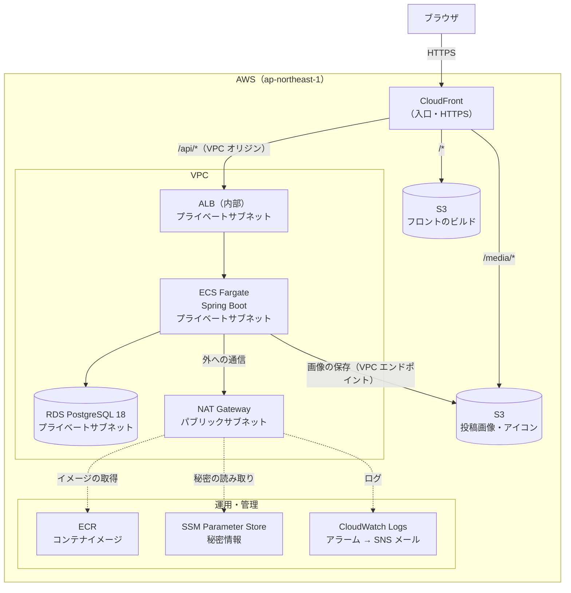

# AWS 構成

[目次に戻る](README.md)

本番環境は AWS の東京リージョン（`ap-northeast-1`）に作る。EC2 は使わず、フロントエンドは S3＋CloudFront で配信し、バックエンド（Spring Boot）は ECS Fargate のコンテナで動かす。

環境は常に置いておかず、**必要なときに Terraform で作ってデプロイし、動作確認が終わったら全部消す**。作り直しは何度でもできる（[作成と削除](#作成と削除)）。

- 決定日：2026-11-21（#6）。2026-11-22 に、NAT Gateway を使う構成（講義の構成に合わせる）と、作って確認したら消す使い方に変更
- 構築（Terraform・ワークフロー）は別の Issue で行う。この文書は構築の設計図として、決めたことと理由を残す

## 構成図



## なぜこの構成か

| 要件・制約 | この構成での対応 |
| --- | --- |
| ログイン状態の Cookie（`SameSite=Strict`）は、フロントと API が同じオリジンでないと送られない | CloudFront を唯一の入口にして、パスで S3 と API に振り分ける（ローカルで Vite が `/api` をプロキシしているのと同じ形） |
| EC2 を使わない | バックエンドは Fargate（サーバーの管理が不要なコンテナ実行環境）で動かす |
| Fargate のタスクは起動のたびに IP アドレスが変わる | ALB を間に置き、新しいタスクへ自動で振り分ける。API Gateway は 1 リクエスト 10MB の上限があり、画像 4 枚の投稿（最大 25MB）が通らないので使わない |
| Fargate はタスクを止めると中身が消える | DB は RDS、画像は S3 に置き、タスクは何も保持しない |
| アプリのサーバーをインターネットから直接触れないようにしたい | Fargate のタスクはプライベートサブネットに置き、公開 IP を付けない。外（ECR・CloudWatch Logs・SSM）への通信は NAT Gateway を通す（講義の構成と同じ） |
| 費用を抑えたい（クレジットは最大 $200） | 環境を置きっぱなしにせず、動作確認が終わったら全部消す。NAT Gateway の固定費（月 約 $45）も、動かしている時間の分（1 時間 約 $0.07）しかかからない（[費用の目安](#費用の目安)） |

講義の構成との違いは ALB だけ。講義では ALB をインターネットに公開するが、ここでは「内部」ALB にして CloudFront の VPC オリジンでつなぐ（CloudFront を通らない API へのアクセスを防げ、ALB の公開 IPv4 アドレスの料金もかからない）。

## 各サービスの役割と設定

### CloudFront

ディストリビューションを 1 つ作り、パスで振り分ける（ビヘイビア）。当面はドメインを取らず、CloudFront の URL（`https://xxxx.cloudfront.net`）をそのまま使う。作り直すたびに URL は変わる。

| パス | オリジン | キャッシュ | 補足 |
| --- | --- | --- | --- |
| `/api/*` | ALB（VPC オリジン） | しない | すべてのメソッド・Cookie・クエリ・ヘッダー（Host 以外）を転送する |
| `/media/*` | S3（画像のバケット） | 長く（1 年） | 画像のキーは内容ごとに変わるので、長くキャッシュしてよい。CloudFront Functions で先頭の `/media` を外して S3 のキーにする |
| `/*`（既定） | S3（フロントのバケット） | `assets/` は長く、`index.html` はしない | 画面のパス（`/home`・`/users/...` など）は CloudFront Functions で `/index.html` に書き換える（SPA のため）。SNS のクローラーからの `/posts/{id}` だけは API に回す（下の OGP） |

- S3 のバケットは公開しない。CloudFront からだけ読めるようにする（OAC）
- SPA の振り分けに「エラー時に `index.html` を返す」設定（カスタムエラーレスポンス）は使わない。この設定はディストリビューション全体にかかり、API の 404（`NOT_FOUND` の JSON）まで `index.html` に置き換えてしまうため。CloudFront Functions を既定のビヘイビアにだけ付ける
- **OGP（投稿の URL を SNS に貼ったときのプレビュー）**：SNS のクローラーは JavaScript を実行しないので、`index.html` からは投稿の内容を読めない。既定のビヘイビアの CloudFront Functions で、User-Agent がクローラー（`Twitterbot`・`facebookexternalhit`（Facebook・LINE）・`Slackbot`・`Discordbot` など。人が使うアプリ内ブラウザの User-Agent に含まれる語は入れない。OGP の HTML から画面に戻ったとき、また回されてしまうため）で、パスが `/posts/{id}` のときだけ、パスを `/api/ogp/posts/{id}` に書き換えてオリジンを ALB に切り替える（CloudFront Functions の `selectRequestOriginById`。2026-11-22 に動くことを確かめた。関数は [infra/terraform/app/functions](../infra/terraform/app/functions)）。バックエンドは OGP の meta タグを入れた HTML を返す。人が開いたときは今までどおり画面が出る
- 料金は無料枠（月 1TB の転送・1,000 万リクエスト）に収まる見込み

### ネットワーク（VPC・ALB・NAT Gateway）

- VPC は 2 つのアベイラビリティゾーンにまたがるパブリック・プライベートサブネットを作る（ALB と RDS のサブネットグループに 2 つ以上が必要なため）
- ALB はプライベートサブネットに置く「内部」ALB にし、CloudFront の **VPC オリジン**でつなぐ
- ヘルスチェックは `/actuator/health`（ログに出さない設定にしてある。[運用](10_operations.md)）
- Fargate のタスクと RDS もプライベートサブネットに置く。どちらも公開 IP を持たない
- **NAT Gateway は 1 台**（片方の AZ のパブリックサブネットに置き、Elastic IP を付ける）。プライベートサブネットのタスクは、これを通って ECR・CloudWatch Logs・SSM に出る。AZ ごとに置くと料金が倍になるので、動作確認用としては 1 台で足りる
- S3 へはゲートウェイ型の VPC エンドポイント（無料）を通す。画像の読み書きが NAT Gateway を通らないので、NAT のデータ処理料金（$0.062/GB）がかからない

| セキュリティグループ | 受け付ける通信 |
| --- | --- |
| ALB | CloudFront から（HTTP 80）。VPC オリジンの通信は VPC 内を通るが、送信元は CloudFront の IP になるので、VPC の CIDR ではなく CloudFront のマネージドプレフィックスリスト（`com.amazonaws.global.cloudfront.origin-facing`）を許可する |
| Fargate のタスク | ALB から（8080） |
| RDS | Fargate のタスクから（5432） |

### ECS Fargate（バックエンド）

- タスクのサイズ：ARM（Graviton）、0.5 vCPU・メモリ 1GB、1 タスク。JVM のヒープはコンテナのメモリの 75% まで（`-XX:MaxRAMPercentage=75`）
- イメージは ECR に置く（[コンテナイメージ](#コンテナイメージ)）。タグは Git のコミット ID
- 環境変数（[application.yml](../backend/src/main/resources/application.yml) の値を上書きする）

    | 変数 | 値 |
    | --- | --- |
    | `DB_URL` | RDS のエンドポイント（`jdbc:postgresql://<RDS>:5432/timeline`） |
    | `DB_USERNAME`・`DB_PASSWORD` | SSM Parameter Store から（秘密） |
    | `JWT_SECRET` | SSM Parameter Store から（秘密。32 バイト以上） |
    | `STORAGE_BUCKET` | 画像のバケット名 |
    | `STORAGE_ENDPOINT` | 空（既定値はローカルの S3Mock なので、必ず空にする。空ならタスクの IAM ロールで本物の S3 につながる） |
    | `STORAGE_PUBLIC_BASE_URL` | `/media`（画像を API ではなく CloudFront から配る） |
    | `APP_PUBLIC_URL` | CloudFront の URL（`https://xxxx.cloudfront.net`）。OGP の URL・画像を絶対 URL にするのに使う。作り直すたびに変わるので、Terraform が CloudFront のドメインを渡す |

- プロファイルは指定しない（本番の設定。ログは JSON、Swagger UI は無効）
- ログは `awslogs` ドライバで CloudWatch Logs の `/timeline-sns/backend` に送る（アプリは JSON を標準出力に出す作りになっている）
- DB のマイグレーション（Flyway）は起動時に自動で流れる。作ったばかりの空の DB にも、起動時にすべてのテーブルが作られる
- 起動にかかる時間（Spring Boot と Flyway）を見込んで、ヘルスチェックの猶予を 3 分ほどとる（手元の PC で 30 秒弱。0.5 vCPU ではそれより遅い）

### RDS（PostgreSQL）

- PostgreSQL 18（スキーマで `uuidv7()` を使うため 18 が必須。構築時に RDS が 18 に対応していることを確かめる）
- `db.t4g.micro`、シングル AZ、ストレージ gp3 20GB
- 公開しない（パブリックアクセスなし）。Fargate のタスクからだけつながる
- 拡張は `pg_trgm` を使う（ユーザー検索。RDS で使える）
- 消す前提なので、削除保護は付けず、削除時の最終スナップショットも取らない。自動バックアップは 1 日（最小）にする

### S3

| バケット | 中身 | 設定 |
| --- | --- | --- |
| フロント | `frontend/` の本番ビルド（`dist/`） | 非公開（CloudFront の OAC）。消すときは中身ごと消す |
| 画像 | 投稿画像・アイコン（[ImageProcessor](../backend/src/main/java/com/timelinesns/image/ImageProcessor.java) で変換済み） | 非公開（CloudFront の OAC）。消すときは中身ごと消す |
| Terraform の状態 | Terraform の状態ファイル | 非公開、バージョニング有効。**これだけは消さずに残す**（最初に手で作る） |

### 秘密情報と権限

- DB の認証情報と `JWT_SECRET` は SSM Parameter Store（SecureString）に置き、タスク定義の `secrets` で環境変数として渡す。値は Terraform で作るたびにランダムに生成し、リポジトリや Terraform のコードには書かない
- IAM ロールは用途ごとに分け、必要な権限だけを付ける

| ロール | 使う人 | 権限 |
| --- | --- | --- |
| タスクロール | 動いているアプリ | 画像のバケットの読み書き・削除 |
| タスク実行ロール | ECS（タスクの起動） | ECR からイメージを取る、CloudWatch Logs に書く、SSM の秘密を読む |
| デプロイ用ロール | GitHub Actions（OIDC） | Terraform で環境を作る・消す、フロントのバケットへの書き込み、CloudFront の無効化、ECR への push、ECS のサービス更新 |

GitHub Actions は OIDC で一時的な認証情報を受け取る。長期のアクセスキーは作らない。デプロイ用ロールは、このリポジトリの main ブランチからだけ使えるように制限する。OIDC の設定とデプロイ用ロールは、環境を消しても残す（次に作るときに使うため。料金はかからない）。

## 作成と削除

環境は必要なときに作り、動作確認が終わったら全部消す。どちらも GitHub Actions の手動実行（`workflow_dispatch`）でボタン 1 つで行う（ワークフローは構築の Issue で作る）。

| 操作 | 手順 | かかる時間 |
| --- | --- | --- |
| 作る | ① `terraform apply` で環境を作る → ② バックエンドのイメージを ECR に push し、ECS のサービスを起動する → ③ フロントをビルドして S3 に置く → ④ `/actuator/health` が UP になるまで待ち、CloudFront の URL を表示する | 20〜30 分（RDS と CloudFront の作成が長い） |
| 動作確認 | CloudFront の URL をブラウザで開き、登録・投稿・画像の表示などを確かめる | 任意 |
| 全部消す | `terraform destroy` で、残す側（ECR・SNS・Budgets・OIDC）と状態ファイルのバケット以外をすべて消す | 10〜20 分 |

- **消すと DB の中身と投稿画像も消える**。作り直したときは空の状態から始まる（ユーザー登録からやり直す）
- 消し忘れると料金がかかり続ける（1 日 約 $3.7）。動作確認が終わったらその日のうちに消す。AWS Budgets の予算アラートで、消し忘れに気づけるようにする
- `terraform destroy` が途中で失敗したら、もう一度実行する。それでも残ったものは AWS のコンソールで確かめて消す

## 費用の目安

東京リージョンのオンデマンド料金（AWS の価格表、2026-11 時点、税別）で計算した。環境があるあいだだけかかる。

| 項目 | 単価 | 1 時間あたり |
| --- | --- | --- |
| NAT Gateway | $0.062/時 ＋ $0.062/GB（処理したデータ） | $0.062 |
| NAT Gateway の Elastic IP（公開 IPv4） | $0.005/時 | $0.005 |
| ALB | $0.0243/時 ＋ $0.008/LCU・時 | $0.03 前後 |
| Fargate（ARM、0.5 vCPU・1GB） | vCPU $0.04045/時、メモリ $0.00442/GB・時 | $0.025 |
| RDS（db.t4g.micro） | $0.025/時 | $0.025 |
| RDS のストレージ（gp3 20GB） | $0.138/GB・月 | $0.004 |
| ECR・S3・CloudFront・CloudWatch・SSM | ほぼ無料枠 | ほぼ $0 |
| **合計** | | **約 $0.15** |

- 例：作って 3 時間動作確認して消すと、**1 回 約 $0.5**（作成・削除の時間を含めると 4 時間で 約 $0.6）
- 消している間にかかるのは、Terraform の状態ファイルのバケット（数 KB）だけで、ほぼ $0
- ALB と NAT Gateway は 1 時間未満でも 1 時間分かかる。Fargate と RDS は秒単位
- 参考：常に動かし続けると月 約 $110。費用のほとんどは NAT Gateway・ALB・RDS の固定費
- クレジット（9/30 時点で約 $158）は、この使い方ならほぼ減らない
- アカウントは無料プランのため 2027-01 ごろに閉じられる。それ以降も使うなら有料プランへ切り替え、AWS Budgets で予算のアラートを設定する（[運用](10_operations.md)）
- 料金は構築するときに AWS の料金ページで確かめ直す

## バックアップと復旧

動作確認が終わったら全部消す使い方なので、残しておくべきデータはない。

| 対象 | 方法 |
| --- | --- |
| インフラ | Terraform のコード。`terraform apply` で何度でも作り直せる |
| フロント・バックエンド | Git。作るたびに、指定したコミットからビルドし直す |
| DB・投稿画像 | 残さない（消すと一緒に消える） |

常に動かす本番に切り替えるときは、データを守る設定を足す（[今後の選択肢](#今後の選択肢)）。

## 構築とデプロイ

### Terraform

- インフラはすべて Terraform で作る。コードはリポジトリの `infra/terraform/` に置く
- 状態ファイルは S3 のバケットに置き、S3 のロック（`use_lockfile`）で同時実行を防ぐ。状態ファイルのバケットだけは最初に手で作る
- 手順は [infra/README.md](../infra/README.md)。構成は 2 つに分ける
  - `infra/terraform/app`（作って消す）：VPC・サブネット・NAT Gateway・セキュリティグループ、S3（フロント・画像）、CloudFront（VPC オリジン・CloudFront Functions）、ALB、ECS（クラスター・サービス・タスク定義）、RDS、SSM Parameter Store、IAM ロール、CloudWatch（ロググループ・メトリクスフィルタ・アラーム）
  - `infra/terraform/persistent`（消さずに残す。費用はほぼ $0）：ECR（環境を作る前にイメージを push できるように。最新 3 個だけ残す）、アラームの通知先の SNS（メールの購読確認を 1 回で済ませるため）、AWS Budgets（月 $5）。GitHub Actions の OIDC とデプロイ用ロールは #93 で足す
- `terraform destroy` で全部消えるように、S3 は中身があっても消せる設定（`force_destroy`）にし、RDS は削除保護なし・最終スナップショットなしにする
- 認証は環境変数で渡す（手元は `AWS_PROFILE=trello-app`、GitHub Actions は OIDC）

### デプロイ（手動）

環境がない時間のほうが長いので、main へのマージでは自動でデプロイしない。「作る」のワークフローの中でデプロイする（[作成と削除](#作成と削除)）。

1. フロント：`npm run build` → S3 に同期（`assets/` は長いキャッシュ、`index.html` はキャッシュしない）
2. バックエンド：ARM のイメージをビルド → ECR に push → ECS のサービスを起動
3. 作ったあとにコードを直して確かめ直したいときは、同じワークフローをもう一度実行する（環境はそのままで、新しい版に入れ替える。CloudFront の `/index.html` も無効化する）

### コンテナイメージ

バックエンドのイメージは [backend/Dockerfile](../backend/Dockerfile) で作る。

- 2 段階で作る。① JDK のイメージで jar を作り、層（ライブラリ・アプリのコード）に分けて取り出す → ② JRE だけのイメージ（`eclipse-temurin:25-jre`）に、変わりにくい順に重ねる。コードだけ変えたときは、送るイメージの差分が小さくて済む
- 本番は ARM（Graviton）なので `linux/arm64` で作る：`docker buildx build --platform linux/arm64 -t timeline-sns-backend backend`。jar は CPU の種類によらないので、①はビルドする PC の CPU のまま動かす（ARM をまねて動かすと何倍も遅いため）
- テスト・静的解析は CI で済んでいるので、イメージを作るときは流さない
- root ではないユーザー（`app`）で動かす。ヒープはコンテナのメモリの 75% まで（`JAVA_TOOL_OPTIONS=-XX:MaxRAMPercentage=75`。1GB なら 768MB）
- ヘルスチェックは ALB が `/actuator/health` で行うので、イメージには入れない

#### 手元で動かして確かめる

本番と同じ設定（プロファイルなし。ログは JSON、Swagger UI は無効）のまま、つなぎ先だけ docker compose の PostgreSQL・S3Mock にして動かせる。8080 を使うので、`bootRun` のバックエンドは止めておく。

```bash
docker compose --profile app up -d --build backend   # 起動（メモリは Fargate と同じ 1GB に制限）
cd frontend && npm run dev                           # 画面は http://localhost:5173（/api は 8080 のイメージに届く）
docker compose --profile app stop backend            # 止める
```

2026-11-22 に、amd64 と arm64（まねて動かしたもの）の両方で、登録・画像付き投稿・画像の配信・OGP まで動くことを確かめた。同じ日に AWS に作り、CloudFront の URL で画面・ログイン（Cookie）・画像付き投稿と `/media` での表示・OGP（クローラーの振り分け）まで動くことを確かめた（0.5 vCPU での起動は 46 秒）。

- 画像を `/media/<キー>` で配る設定（`STORAGE_PUBLIC_BASE_URL=/media`）は CloudFront があって初めて動くので、AWS に作ったあとに確かめる（#91）
- メール（SES）は使わない（メールを送る機能は作らない）

## 今後の選択肢

- 常に動かす本番にする：RDS の削除保護・自動バックアップ（7 日）・最終スナップショット、画像のバケットのバージョニングを有効にし、main へのマージで自動デプロイする。費用は月 約 $110。NAT Gateway の代わりに Fargate をパブリックサブネットに置けば、月 約 $45 下げられる
- 独自ドメイン：Route 53 でドメインを取り、ACM の証明書を CloudFront に付ける。URL が変わるだけで、構成は変わらない
- 利用者が増えたら：Fargate のタスク数を増やす（画像は S3、DB は RDS にあるので、そのまま増やせる）。RDS のサイズを上げる
